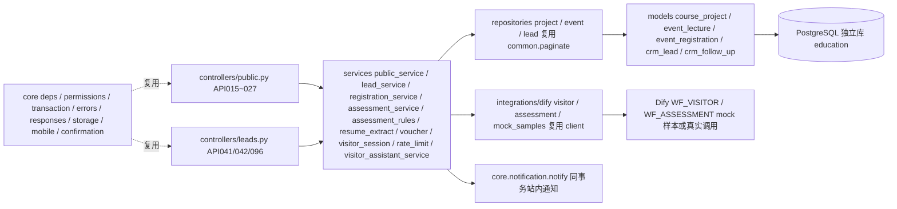

## 产品概述
本次为「粤教留学服务平台」补齐 M2「访客客服与客户研判」的**纯后端**能力（不做前端页面）。模块职责是打通"访客咨询 → 确认为真实线索 → 顾问获得可核对的项目研判"这条链路，并对外提供已发布项目与开放活动的公开查询，对内提供项目与活动维护、客户留资、活动报名、私有简历提取与客户研判接口，AI 部分通过 Dify 工作流完成访客问答与简历字段提取。

开发在既有分层架构（controllers / services / repositories / models / integrations）上进行，不修改项目地基（main.py、core/、db/、deploy/schema.sql）。M4 学生模块已交付，本次需复用其模型与适配器资产，避免重复实现。

## 核心功能
- **三渠道统一获客**：表单、客服对话、活动报名共用同一获客入口；统一手机号规范化与查重复用（同手机号不重复建客户）、完整度（MINIMAL/COMPLETE）与销售状态（NEW/FOLLOWING/SIGNED/LOST）分离、按项目默认部门路由（无默认部门则进管理员待分配池）；匿名响应不泄露客户是否存在、姓名、顾问与阶段；缺姓名或手机号时不落正式客户，仅保留短期会话草稿。
- **项目与活动**：公开列表与详情仅返回已发布项目、开放活动（含剩余名额 remainingCapacity）；员工创建项目草稿、修改并发布、审核结构化准入规则（未审核则不作自动判定）；员工创建活动并开放或取消（取消时不得把名额降到已报名数以下）。
- **活动报名与取消**：报名在数据库行锁内复查活动状态、报名截止与容量；同一活动同一手机号不重复；学生报名绑定本人档案并从本人资料取名与手机号，访客报名必须绑定线索；取消释放名额并回收凭据；报名与取消遵守同一锁序。
- **私有简历与事实核对**：顾问对有权客户上传私有简历，先返回可编辑的提取草稿（含来源片段与缺失项），不改写正式客户事实与销售状态。
- **客户研判**：记录请求号与乐观锁版本后，在事务外调用 AI 做字段提取；由后端按已审核的项目准入规则逐项目给出 MATCH / NO_MATCH / NEEDS_INFO；未配置规则返回 NEEDS_INFO 且不给分数；过时请求不得覆盖最新结果；失败保留上一份成功报告并标记为历史报告。
- **访客客服**：公开限流下的问答与会话草稿；不泄露客户库明细；可返回留资或报名草稿提议，由用户确认后再调用普通业务接口；AI 不可用时返回降级回答，不影响表单与查询。
- **AI 工作流（mock 优先）**：离线样本返回符合约定的结构化 JSON，配置密钥后即可切换真实调用。
- **联调与清理**：可在独立业务库上建表、造种子、跑自有用例与端到端手验，验证完成后按清单清理测试数据。


## 技术栈
- 语言与框架：Python 3.11 + FastAPI（复用现有 `backend/app`），Pydantic v2、SQLAlchemy 2.0
- 数据库：PostgreSQL 16，驱动 `psycopg[binary]`（已装）；连接阿里云实例但**新建独立业务库 `education`**，绝不写入其自带的 `dify` 库
- AI：Dify（复用 `integrations/dify/client.py` 的 `DifyClient` 与 `__init__.py` 的 `run_workflow`），`dify_mode=mock|live` 双模式；复用 `settings.dify_base_url / dify_visitor_key / dify_assessment_key`
- 测试：pytest + httpx，沿用现有 `backend/tests` 模式（原生 SQL 造数 + 前缀清理），M2 统一使用 `m2_%` 与 `m2%` 前缀
- 新增可选依赖：`pypdf`、`python-docx` 写入 `backend/requirements-m2.txt`，不改共享 `requirements.txt`；未安装时降级为 422 `NO_READABLE_TEXT`
- 不引入 Redis、消息队列等新中间件

## 实现方案
整体沿用现有四层架构：Controller 取身份与解析入参 → Service 管业务规则与事务边界 → Repository 做带范围查询（不自行 commit）→ Model 映射十九表。AI 调用全部放在事务之外。

### 关键决策与取舍
1. **不动地基**：不碰 `main.py` / `core/**` / `db/**` / `deploy/schema.sql`。M2 需要的配置项（dify 模式、访客限流、会话 TTL、研判回收阈值）经 `services/m2_config.py` 桥接。因 `Settings` 为 `extra="ignore"`，`.env` 中未声明的键不会进入 settings，故在 `m2_config` 增加 `os.environ` 兜底（settings 属性 → os.environ → 默认值），保证"mock 优先、可切 live"真正生效，且仍不改 `core/config.py`。
2. **复用 M4 资产，避免双映射**：`models/course_project.py`（M4 已建，文件头声明该表由 M2 写入）与 `models/follow_up.py`（字段完整）直接复用，只在 `course_project.py` 追加缺失的 5 列；`integrations/dify/client.py`、`schemas/assistant.py`、`repositories/common.py` 的 `paginate`、`core/mobile.py` 均复用，不新建同功能文件。`crm_lead` 保持"一张表一个映射类"，仅在 `models/lead.py` 上追加剩余列。
3. **修复既有模型缺陷**：`models/lead.py` 的 `dept_id` 现为非空，与 DDL 中 `crm_lead.dept_id` 可空不符，会导致未路由客户的留资无法落库，必须放宽为可空。该文件是本模块唯一修改已有定义之处，均为新增列加一处类型放宽，需在文档记录并与 P1/M3 同步。
4. **访客取消凭据**：`core/confirmation` 的签名绑定登录 actor，访客无账号不适用。改为对 `(event_id, registration_id, request_key)` 做确定性 HMAC 签名，明文只随首次成功响应返回，库中仅存 sha256 哈希（`cancel_token_hash`）；同一 `request_key` 重试可重建完全相同的凭据，不同键重复报名只返回泛化重复提示。
5. **限流与会话草稿**：无 Redis，采用进程内实现（令牌桶按 IP 与会话；会话草稿 TTL 字典按 `visitor_session_ttl_minutes`），在代码注释与文档中明确"仅适用单实例开发环境"。
6. **事务一致性**：报名与取消锁活动行；留资的"复用或创建客户 + 获客跟进"同事务；研判"写请求号 → 事务外 AI → 按请求号条件回写"分两段，避免长事务持有客户行锁。
7. **规则判定与 AI 分离**：AI 只做字段提取、证据定位与解释；decision 与 score 由后端依据已审核的 `course_project.admission_rules` 确定性计算；规则缺失即 NEEDS_INFO、score 为 null，杜绝 AI 编造门槛与分数。
8. **附件校验放宽**：M1 的 API028 只返回 `{objectKey, filename}`，未提供 04 文档要求的 upload_proof。API096 与 API041 仅校验 `object_key` 前缀为 `u/{actor_id}/` 且 `core.storage.resolve_path` 能解析到文件；请求体保留 `upload_proof` 为可选字段（传了只做非空校验），兼容后续 M1 补齐。
9. **响应命名对齐现状**：请求体统一 snake_case；响应字段统一 camelCase（与 M1 的 auth、M4 全部接口一致）；分页响应统一 `{items, page, pageSize, total}`。

### 性能与可靠性
- 公开列表的 count 与 items 使用同一过滤条件，直接复用 `repositories/common.paginate`；剩余名额用一次聚合查询（LEFT JOIN 与 COUNT）计算，避免逐行查询；列表强制稳定排序（create_time 与 id）防分页漏项。
- 报名并发：`SELECT ... FOR UPDATE` 锁定 `event_lecture` 行后统计有效报名数并复查容量，叠加数据库唯一约束 `(event_id, mobile)` 双保险；取消用乐观锁 version。
- 研判回写使用条件更新 `WHERE id=? AND assessment_request_id=?`，旧任务自然失效；失败只保存符号错误码，`assessment_started_at` 供超时回收，避免永远停在 RUNNING。
- 日志复用现有 `logging`，只记录 request_id、actor、entity、result、error_code；手机号用 `mask_mobile` 脱敏；临时密码与取消凭据一律不入日志。
- 影响面控制：仅替换 `controllers/public.py` 全部占位实现与 `controllers/leads.py` 中 API041 / API042 / API096 三处；其余文件保持原样。

### 执行注意事项
- 复用而非新建：`models/follow_up.py`、`integrations/dify/client.py`、`schemas/assistant.py`（API027 必须复用其 `AssistantRequest` 与 `AssistantResult`，否则同一路径会出现两套结构）、`repositories/common.paginate`、`core/mobile.normalize_mobile` 与 `mask_mobile`。
- 共享文件只增不改（已获授权）：`models/lead.py`、`models/course_project.py`、`tests/conftest.py`、`integrations/dify/__init__.py`、`dify/variables.md`、`dify/eval_samples.md`；不得改动 M4 已有字段、函数与 fixture。
- 测试库隔离：`tests/conftest.py` 追加库名护栏（断言当前库名非 dify，否则失败），M2 夹具统一 `m2_%` 前缀，避免与 M4 的 `m4_%` 清理互删。
- 敏感数据：匿名留资响应不返回客户是否存在与客户标识；公开页面不返回员工手机号与未发布项目。
- 术语与枚举一律英文，中文仅用于展示；ID 一律十进制字符串。

## 架构设计


## 目录结构
本次为在既有项目上新增 M2 后端能力，主体为新增文件，少量按约定"只增不改"扩展现有文件。

```text
backend/
├── app/
│   ├── models/
│   │   ├── lead.py                 # [MODIFY] 仅追加 crm_lead 剩余列（性别/城市/学历/生日/留学目的/意愿/完整度/画像/简历键/研判请求号与状态/签约与流失/request_key/version/next_follow_up_at），并把 dept_id 放宽为可空；不改已有字段
│   │   ├── course_project.py       # [MODIFY] M4 已建，仅追加 default_dept_id / admission_rules(JSONB) / rule_version / rule_approved_at / rule_approved_by
│   │   ├── event.py                # [NEW] EventLecture（活动与名额）与 EventRegistration（报名与取消凭据哈希）
│   │   ├── follow_up.py            # [复用] M4 已建，字段完整，不新建
│   │   └── __init__.py             # [MODIFY] 追加导出 M2 新增模型
│   ├── schemas/
│   │   ├── common.py               # [MODIFY] 追加分页入参解析与分页封装（camelCase 的 page/pageSize/total）；保留 M4 的 VersionRequest 与 VersionReasonRequest
│   │   ├── project.py              # [NEW] 项目公开 DTO、员工项目 DTO、创建与更新请求（禁止未知字段）
│   │   ├── event.py                # [NEW] 活动 DTO、创建与更新请求、报名请求、取消请求、报名 DTO
│   │   ├── lead.py                 # [NEW] 留资请求（FORM 与 ASSISTANT 两套最小校验）、研判请求、简历提取请求、研判报告与查询响应
│   │   └── assistant.py            # [复用] API027 复用 M4 的 AssistantRequest 与 AssistantResult，不改 M4 字段
│   ├── repositories/
│   │   ├── project.py              # [NEW] 公开项目与员工项目查询、编码唯一性校验；不 commit
│   │   ├── event.py                # [NEW] 活动查询、剩余名额聚合、有效报名计数；不 commit
│   │   ├── lead.py                 # [NEW] 按手机号查客户、按范围取客户、留资复用判定；不 commit
│   │   └── common.py               # [复用] paginate 与 my_profile_id 等
│   ├── services/
│   │   ├── public_service.py       # [NEW] 项目与活动的创建、发布审核、开放与取消、公开查询与 DTO 归一化
│   │   ├── lead_service.py         # [NEW] capture_lead：手机号规范化、查重复用、完整度计算、部门路由、ACQUIRED 跟进、统一回执（匿名不泄露）
│   │   ├── registration_service.py # [NEW] 报名、取消、我的报名：行锁复查容量、学生绑本人、访客绑线索、幂等与并发
│   │   ├── assessment_rules.py     # [NEW] 依已审核准入规则逐项目判定 MATCH / NO_MATCH / NEEDS_INFO，score 仅在有权重时计算
│   │   ├── assessment_service.py   # [NEW] assess_lead：请求号与版本落库 → 事务外 AI → 按请求号条件回写；失败保留上一份并标记历史报告
│   │   ├── resume_extract.py       # [NEW] 简历文本抽取（pdf 与 docx），无可读文本抛 422 NO_READABLE_TEXT
│   │   ├── voucher.py              # [NEW] 访客取消凭据：确定性 HMAC 签名与 sha256 校验
│   │   ├── visitor_session.py      # [NEW] 访客会话草稿 TTL 缓存（进程内，重启丢失，注释注明）
│   │   ├── rate_limit.py           # [NEW] 进程内令牌桶（IP 与会话），超限抛 429 RATE_LIMITED
│   │   ├── visitor_assistant_service.py # [NEW] 访客问答与留资或报名草稿提议，拼装 AssistantResult
│   │   └── m2_config.py            # [MODIFY] 增加 os.environ 兜底，使 dify_mode 与限流、TTL 可经 .env 切换
│   ├── integrations/dify/
│   │   ├── visitor.py              # [NEW] WF_VISITOR：公开问答、留资草稿、活动意向分支与输出校验
│   │   ├── assessment.py           # [NEW] WF_ASSESSMENT：facts / evidence / missing_fields 提取与输出校验
│   │   ├── mock_samples.py         # [NEW] mock 模式的确定性离线样本
│   │   ├── client.py               # [复用] M4 的 DifyClient，不改
│   │   └── __init__.py             # [MODIFY] 仅追加 M2 导出，不改 M4 的 run_workflow 与 call_student_workflow
│   └── controllers/
│       ├── public.py               # [MODIFY] 替换 API015~API027 全部占位实现
│       └── leads.py                # [MODIFY] 仅实现 API041 / API042 / API096，其余占位保持原样
├── scripts/
│   ├── m2_db.py                    # [NEW] 云库工具：init（建独立库并执行 schema.sql）、seed、drop（清理），内置"库名不得为 dify"护栏
│   └── seed_m2.py                  # [NEW] M2 种子：带准入规则的项目样例、开放活动、演示客户（幂等），不改公共 seed.py
├── tests/
│   ├── conftest.py                 # [MODIFY] 追加 M2 夹具（m2 前缀）与建库护栏；不改 M4 现有夹具
│   ├── test_m2_project_event.py    # [NEW] 未发布不可见、时间与币种一致、活动状态与容量、编码重复
│   ├── test_m2_lead_capture.py     # [NEW] 三渠道统一、重复手机号不重复客户、完整度分离、未路由部门、匿名不泄露
│   ├── test_m2_registration.py     # [NEW] 剩 1 名额并发仅 1 成功、取消释放、凭据校验与同 request_key 重试同凭据
│   ├── test_m2_assessment.py       # [NEW] 缺规则返回 NEEDS_INFO 且分数为空、旧任务不覆盖、简历无权与缺项、扫描 PDF
│   ├── test_m2_assistant.py        # [NEW] 客服草稿不落库、限流、AI 不可用降级
│   └── test_m2_dify_contract.py    # [NEW] mock 与 live 输出契约、错误码映射
├── requirements-m2.txt             # [NEW] M2 可选依赖（pypdf、python-docx），未安装则降级
└── .env                            # [MODIFY，不入库] 指向云库独立库 education，并设置 dify_mode 等

dify/
├── wf_entry.yml                    # [NEW] WF_VISITOR DSL（不含 key，导入后重绑知识库与模型）
├── wf_profile.yml                  # [NEW] WF_ASSESSMENT DSL
├── variables.md                    # [MODIFY] 追加 WF_VISITOR 与 WF_ASSESSMENT 的输入输出变量章节
├── eval_samples.md                 # [MODIFY] 追加 M2 评测样本（未配置规则不给分、要求导出客户库等）
└── README.md                       # [MODIFY] 修正文件清单（wf_student 与 wf_entry、wf_profile）

docs/
└── M2-01-访客客服与客户研判-开发说明.md  # [NEW] 实现说明、协作边界、联调步骤、云端清理步骤与验收证据

backend/app/main.py、core/**、db/**、deploy/schema.sql   # 不修改
```

## 关键接口契约
Dify 统一输出契约（适配器按 mode 校验，mock 与 live 共用）：
```json
{
  "schema_version": "1.0",
  "mode": "ASSESSMENT_EXTRACT | VISITOR_ANSWER",
  "facts": { "education": "客户确认的学历" },
  "evidence": [{ "field": "education", "source_ref": "resume:p1", "snippet": "最小必要原文片段" }],
  "missing_fields": ["language_level"],
  "warnings": []
}
```
适配器对外签名（mock 与 live 可替换，AI 调用必须在事务外）：
```python
def run_visitor(payload: dict, *, timeout_s: int) -> dict: ...      # 失败抛 AIUnavailableError / AITimeoutError / AIBadResponseError
def run_assessment(payload: dict, *, timeout_s: int) -> dict: ...   # 同上
```
访客取消凭据（确定性，故同 request_key 重试得到同一凭据）：
```python
def sign_cancel_voucher(event_id: int, registration_id: int, request_key: str) -> str: ...
def verify_cancel_voucher(token: str, event_id: int, registration_id: int, request_key: str) -> bool: ...
```

## 云端验证环境
- 前置校验：TCP 连通 `8.138.150.132:5433`（安全组需放行且来源含开发机公网 IP）；`postgres` 具备 `CREATE DATABASE` 权限；本机无需 psql，统一用 Python 加 psycopg。
- 建库：在云实例新建独立库 `education`，执行 `deploy/schema.sql`（19 表、索引、触发器）；严禁连接或写入其 `dify` 库。
- 隔离：`backend/.env` 指向 `education`；`scripts/m2_db.py` 与 `tests/conftest.py` 内置库名护栏。
- 清理：跑完给出待删清单，确认后 `DROP DATABASE education`（不可逆）；凭据只留在本地 `.env`（已 gitignore），不进入任何提交内容或日志。


### SubAgent
- **code-explorer**
  - Purpose: 在动手前核对 `models/lead.py`、`models/course_project.py`、`core/permissions.py`、`controllers/public.py`、`controllers/leads.py`、`integrations/dify/__init__.py` 的既有定义与调用点，确认新增模型与服务无同表双映射、无命名冲突，并定位 M2 归属的占位实现边界。
  - Expected outcome: 输出精确的改动清单与冲突结论（例如 crm_lead 单映射类可行、Scope 的 own_field 为 owner_user_id、M4 已建 model 与适配器需复用），避免越界改动与重复实现。

### Skill
- **lsp-code-analysis**
  - Purpose: 对 `models/lead.py`、`models/course_project.py`、`services/m2_config.py`、`integrations/dify/__init__.py` 等改动点做定义、引用与调用层级分析，确认"只增不改"不会破坏 M1/M3/M4 的现有调用。
  - Expected outcome: 给出符号引用清单与影响面结论，确保仅替换 M2 归属实现，其余调用方不受影响。
- **pdf**
  - Purpose: 生成测试用简历夹具，包含一份带文本层的 PDF 与一份图片型 PDF，用于验证简历文本抽取与 NO_READABLE_TEXT 分支。
  - Expected outcome: 可复用的测试夹具 PDF 与文本抽取结果，覆盖"扫描 PDF 不假装识别成功"的验收点。
- **agent-browser**
  - Purpose: 在端到端验收阶段通过浏览器打开 Swagger UI，按顺序调用"留资 → 报名 → 研判 → 简历提取 → 访客客服"，留存可核对证据。
  - Expected outcome: 全链路调用截图与响应记录，证明从留资到研判真实可跑通，并支持清理前后的数据核对。
