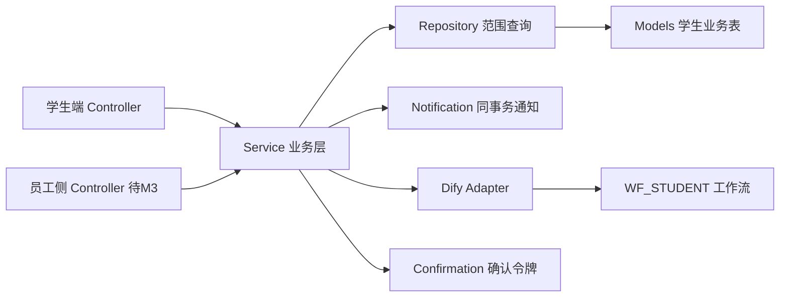

# M4 学生助手模块后端与 WF_STUDENT 工作流开发

## 产品概述

在 M1 已冻结的公共地基（认证、数据范围 Scope、事务、通知、确认令牌、异常体系、Dify 配置）之上，为「学生助手模块（M4）」实现完整后端业务与 `WF_STUDENT` 学生智能助手 Dify 工作流。本次不开发学生端 Vue 页面（交给 M5），只交付接口与页面逻辑说明；M3 的员工侧接口只提供可复用的业务函数，不写 M3 控制器。

## 核心功能

- 学生本人概览（API046）、签约前评估可见摘要（API093）、升学意向确认（API095）
- 成绩查询（API073/074）、教务日程与单次提醒（API076/077）
- 申请进度当前列表与时间线（API078/079）
- 行政服务：学生提交/取消请假、考务、信息修改（API050/051/052/053），导出 `decide_service` 业务函数供 M3 审批复用
- 售后工单：学生提交/列表/详情/确认关闭/重开/评价（API056/057/058/063/064/065），导出 `handle_feedback` 业务函数供 M3 处理复用
- 心理关怀：授权/撤回（API066）、按班级/姓名查日状态（API067）、受限观测历史（API068）、主管人工修正（API069）、受限预警列表/详情（API070/071），导出 `observe_emotion`、`get_daily_final_states`、`review_alert` 业务函数供 M3 复用
- 学生智能助手（API030）：学务查询、生活问答、申请草稿、售后草稿、升学意向；写操作先返回提议卡片与确认令牌，确认后走普通业务接口
- Dify 适配器与 `dify/wf_student.yml`（Dify 1.12.1 可导入，LLM 模型选择与 RAG 节点留空）

## 关键边界

- 不改动 `backend/app/core/`、`db/`、`deploy/schema.sql`、`main.py` 等 M1 地基
- 数据查询统一走 Scope 范围过滤；心理与投诉正文需显式敏感授权
- 学生侧接口严格按 04 文档的请求/响应 DTO 白名单，敏感字段（priority、心理原文、password_hash）不外泄

## 环境与云端配置（2026-10-16 补充）

- **Dify 云端**：`http://8.138.150.132/`（Dify 1.12.1）。后端通过 `.env` 配置 `DIFY_BASE_URL=http://8.138.150.132` 与 `DIFY_STUDENT_KEY=<workflow key（后续提供）>`；`core/config.py` 已内置这些配置项，**无需改代码**，只在 `.env` 填值。
- **业务库与 Dify 内部库分离**：云端 PostgreSQL `8.138.150.132:5433` 的 `dify` 库是 **Dify 自身的元数据库**，不是本项目业务库。本模块（M4 及 19 张业务表）连接的是**业务库 `education`**（开发期本地 `deploy/docker-compose.yml` 的 `localhost:5432/education`）。两者不可混用；将来业务库迁云端只改 `.env` 的 `DATABASE_URL`，不动代码。
- **密钥安全**：Dify 登录密码、DB 密码、workflow key 一律写入 `.env`（已在 `.gitignore`），**绝不提交 git**，也不写进 Dify 工作流提示词或文档。

## 技术栈

- 后端：Python 3 + FastAPI + SQLAlchemy 2.0 + Pydantic v2 + PostgreSQL（沿用现有项目，不改动依赖核心）
- 分层：Controller → Service → Repository → Model，复用 `app/core/` 公共能力
- Dify：1.12.1，`WF_STUDENT` 为 **Workflow 类型应用**（工作流 app，Start/End 节点，非 Chatflow），交付可导入 `.yml`，经 `POST /v1/workflows/run` 调用
- 测试：pytest（沿用现有 6 个 M1 测试的写法与 fixture 风格）

## 实现方案

在现有空壳上「填实而非重建」：M4 相关的 5 个 Controller 文件保留现有路由与函数名（全路径、无 prefix），只把 `_todo()` 替换为真实实现并补充请求体 Schema；新增 8+1 张表模型、DTO、Repository、Service、Dify 适配器。

关键决策：

- 班主任/顾问/主管/学生本人的数据范围过滤在 **Repository 层**自行拼装（基于 `Scope.class_teacher_of`、`is_head_of`、`own_field`、`_profile_id` 等公开字段），不改 `core/permissions.py`。
- 心理观测流程：授权有效才观测；先 Python 直接风险词命中立即落 RULE 观测 + HIGH 告警，再在事务外调 Dify 分析；保存前重查授权；`source_event_key` 去重；同日多版本取最后有效。
- 写操作统一 `request_key` + `expected_version` 乐观锁；助手写操作返回 proposal + `confirmation_token`，确认后走普通接口再鉴权。

## 架构设计



## 目录结构

```
backend/
├── app/
│   ├── models/
│   │   ├── student.py            # [MODIFY] 补全 StudentProfile 全字段
│   │   ├── enrollment.py         # [NEW] StudentCourseEnrollment 模型
│   │   ├── admin_service.py      # [NEW] StudentAdminService 模型
│   │   ├── academic_schedule.py  # [NEW] StudentAcademicSchedule 模型
│   │   ├── score.py              # [NEW] StudentScore 模型
│   │   ├── feedback_ticket.py    # [NEW] StudentFeedbackTicket 模型
│   │   ├── psych.py              # [NEW] StudentPsychProfile + StudentPsychAlert 模型
│   │   ├── application_progress.py # [NEW] StudentApplicationProgress 模型
│   │   └── follow_up.py          # [NEW] CrmFollowUp 模型（API095 升学意向，与 M3 共用）
│   ├── schemas/
│   │   ├── student.py            # [NEW] 学生/成绩/日程/进度 DTO 与请求 Schema
│   │   ├── service.py            # [NEW] 行政服务请求/响应 DTO
│   │   ├── feedback.py           # [NEW] 售后工单请求/响应 DTO
│   │   ├── psych.py              # [NEW] 心理授权/观测/预警 DTO
│   │   └── assistant.py          # [NEW] AssistantRequest/AssistantResult 及 Dify 输出校验 Schema
│   ├── repositories/
│   │   ├── student_repo.py       # [NEW] 学生档案/成绩/日程/进度范围查询
│   │   ├── service_repo.py       # [NEW] 行政服务范围查询
│   │   ├── feedback_repo.py      # [NEW] 售后工单范围查询
│   │   ├── psych_repo.py         # [NEW] 心理观测/日状态/预警范围查询
│   │   └── academic_repo.py      # [NEW] 教务/申请进度范围查询
│   ├── services/
│   │   ├── student_service.py    # [NEW] get_self_overview 等学生档案/成绩/日程/进度业务
│   │   ├── feedback_service.py   # [NEW] submit_feedback/handle_feedback/confirm/reopen/rate
│   │   ├── psych_service.py      # [NEW] observe_emotion/get_daily_final_states/review_alert 等
│   │   ├── academic_service.py   # [NEW] 成绩/日程提醒/申请进度/升学意向业务
│   │   └── student_assistant_service.py # [NEW] 学生助手消息编排（意图分类→查询/草稿→确认令牌）
│   ├── controllers/
│   │   ├── students.py           # [MODIFY] 填实 API046/073/074/076/077/078/079/093/095
│   │   ├── services.py           # [MODIFY] 填实 API050/051/052/053（054/055 保留 _todo 给 M3）
│   │   ├── feedback.py           # [MODIFY] 填实 API056/057/058/063/064/065（059-062 保留 _todo）
│   │   ├── psych.py              # [MODIFY] 填实 API066/067/068/069/070/071（072 保留 _todo）
│   │   └── assistants.py         # [MODIFY] 填实 API030（029/031 保留 _todo）
│   └── integrations/dify/
│       ├── __init__.py           # [MODIFY] 实现 Dify 适配器（选工作流/payload_json/超时/output_json 校验/降级）
│       └── client.py             # [NEW] HTTP 调用与重试/超时封装
├── scripts/
│   └── seed.py                   # [MODIFY] 扩展 M4 测试数据
└── tests/
    ├── test_student_service.py   # [NEW] 行政服务提交/取消/重叠/版本冲突测试
    ├── test_feedback.py          # [NEW] 售后提交/处理/保密/重开/评价测试
    ├── test_psych.py             # [NEW] 心理授权/日状态/风险规则/预警处置测试
    └── test_academic.py          # [NEW] 成绩/日程提醒/申请进度/升学意向测试

dify/
├── wf_student.yml                # [NEW] Dify 1.12.1 可导入工作流（LLM 模型留空、RAG 节点留空）
├── variables.md                  # [NEW] WF_STUDENT 输入输出变量说明
└── eval_samples.md               # [NEW] 30 条评测样本

docs/
└── M4-学生页面逻辑说明.md         # [NEW] 学生端页面逻辑与接口映射（给 M5 整合）
```

## 关键代码结构

M4 对外业务 Interface（供 M3 控制器复用，均在 services 内实现，不写 M3 控制器）：

```python
def get_self_overview(db, user) -> StudentSelfDTO: ...
def submit_service(db, user, req: ServiceCreateRequest) -> ServiceSubmitResult: ...
def decide_service(db, actor, service_id, req: ServiceDecisionRequest) -> ServiceDTO: ...
def submit_feedback(db, user, req: FeedbackCreateRequest) -> FeedbackStudentDTO: ...
def handle_feedback(db, actor, ticket_id, req: FeedbackHandlingRequest) -> FeedbackStaffDTO: ...
def observe_emotion(db, student_profile, event) -> None: ...
def get_daily_final_states(db, student_profile_id, days: int) -> list: ...
def review_alert(db, actor, alert_id, req: PsychActionRequest) -> PsychAlertDTO: ...
def append_application_event(db, actor, case_no, req: ApplicationAdvanceRequest) -> ApplicationEventResult: ...
```

Dify 适配器与 WF_STUDENT 调用约定（Dify 1.12.1 Workflow 应用）：

```python
def call_student_workflow(*, payload: dict, user_id: int, timeout: float = 45.0) -> dict:
    # POST {DIFY_BASE_URL}/v1/workflows/run
    # header Authorization: Bearer {DIFY_STUDENT_KEY}
    # body {"inputs": {"payload_json": json.dumps(payload)},
    #       "response_mode": "blocking", "user": str(user_id)}
    # 解析 data.outputs.output_json -> Schema 校验 -> 返回标准结果
```

WF_STUDENT 的 output_json 结构：

```
{
  "schema_version": "1.0",
  "answer": "请核对请假时间和原因",
  "intent": "SERVICE_DRAFT",
  "draft": {"service_type": "LEAVE", "start_at": "...", "end_at": "...", "description": "..."},
  "missing_fields": [],
  "sources": [],
  "warnings": [],
  "observation": {"emotion_state": "UNKNOWN", "direct_signal": false, "confidence": 0.3}
}
```

## 实施要点

- **命名约定**：请求 DTO 用 snake_case（对齐 04 文档），响应 DTO 用 camelCase（对齐现有 `UserOut/LoginOut` 风格），ID 一律转字符串；Controller 保持现有「全路径、无 prefix」写法，不改 `main.py`。
- **性能**：列表查询用 `scope.apply()` 在 SQL 层过滤；心理日状态利用 `ix_psych_daily_latest` 索引，告警利用 `uq_psych_open_student` 唯一索引保证一学生一未关闭告警；请假重叠检测在 `student_profile` 行锁内；AI 调用放事务外。
- **日志**：复用现有 logging；心理/投诉读取记录访问事件，不记录密码/token/投诉正文/心理原文；Dify 失败记 `DETECTION_UNAVAILABLE`，不伪造健康观测。
- **爆炸半径**：以新增文件为主，Controller 只替换 M4 部分 `_todo()`，保留 M3 的 `_todo()` 占位不动；不改 `core/`、`deploy/schema.sql`、`main.py`。