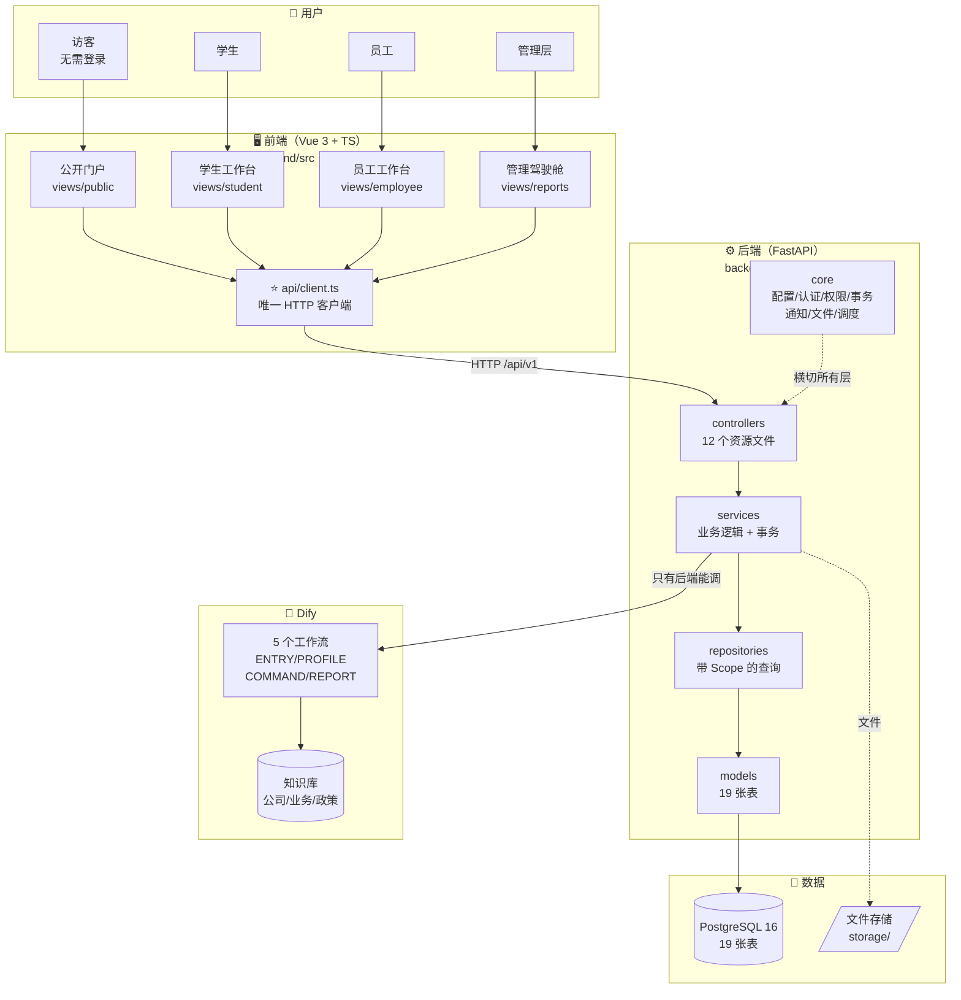
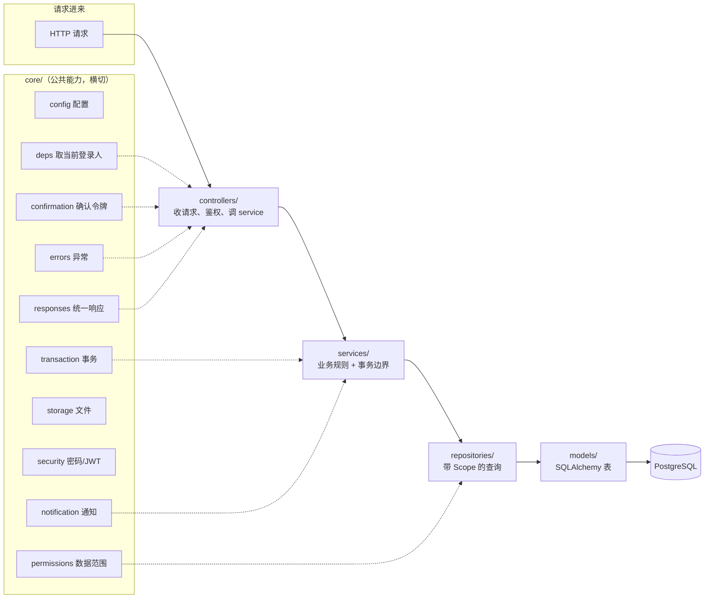
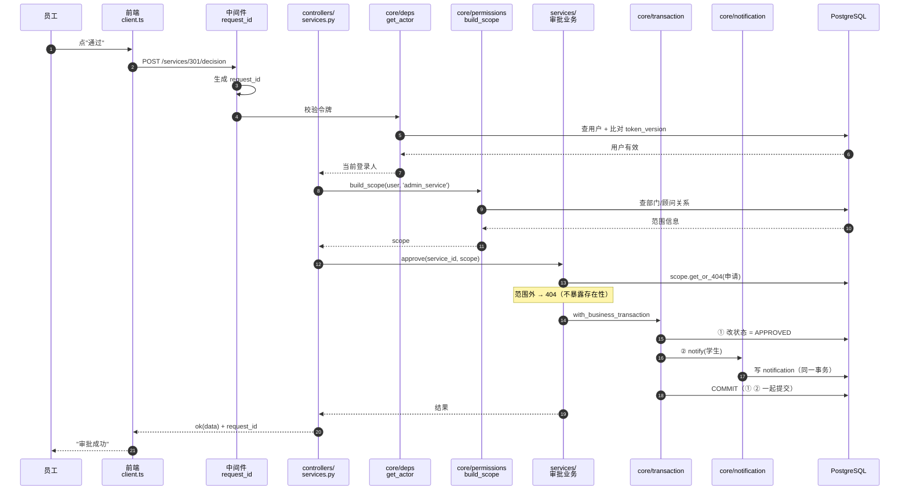
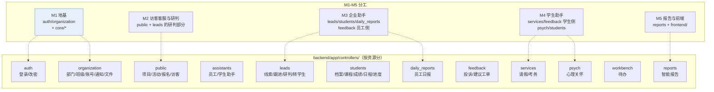
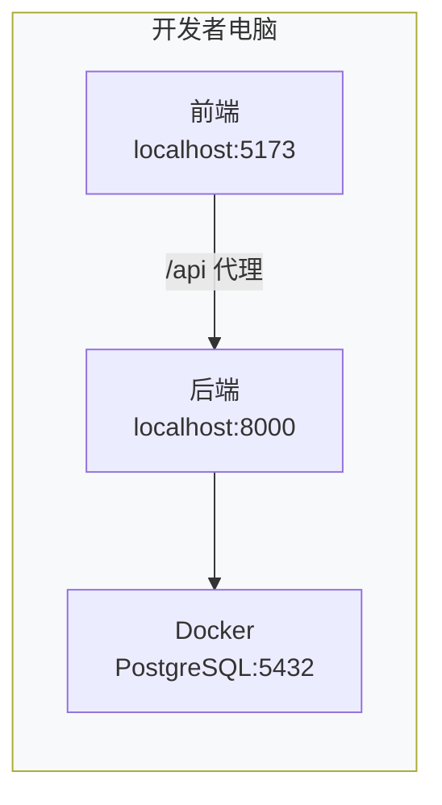
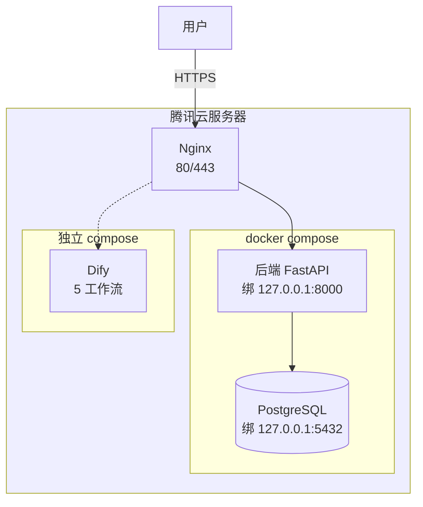

# 架构图

> 状态：**已定稿**　日期：2026-10-16　负责人：P1（M1）
> 读者：**全员**（理解系统怎么运转）

---

## 一、交付内容

| # | 图 | 说明 |
|---|---|---|
| 1 | **系统总览** | 四个部分怎么连 |
| 2 | **后端分层** | 每层职责 |
| 3 | **一次请求的链路** | ⭐ 最重要，看懂就知道代码怎么写 |
| 4 | **模块划分** | M1-M5 各管什么 |
| 5 | **部署架构** | 本地 / 云端 |

---

## 二、系统总览

### 📋 纯文本版（微信/记事本直接看）

```
   用户                  前端(Vue)               后端(FastAPI)              数据
┌─────────┐          ┌──────────────┐        ┌─────────────────┐      ┌──────────┐
│ 访客     │─────────▶│  公开门户     │        │                 │      │          │
│ 学生     │─────────▶│  学生工作台   │        │  controllers/   │      │PostgreSQL│
│ 员工     │─────────▶│  员工工作台   │───────▶│   ↓             │─────▶│ 19 张表  │
│ 管理层   │─────────▶│  管理驾驶舱   │ HTTP   │  services/      │      │          │
└─────────┘          │      ↓       │ /api/  │   ↓             │      └──────────┘
                     │ api/client.ts│  v1    │  repositories/  │
                     │  (唯一出口)   │        │   ↓             │      ┌──────────┐
                     └──────────────┘        │  models/        │      │ 文件存储  │
                                             │                 │─────▶│ storage/ │
                     ┌──────────────┐        │  core/  ★横切    │      └──────────┘
                     │              │        │  认证/权限/事务   │
                     │   Dify       │◀───────│  通知/文件/调度   │      ┌──────────┐
                     │ 5 个工作流    │ 只有   └─────────────────┘      │  知识库   │
                     │ (后端才调)    │ 后端调                        │ 公司/业务 │
                     └──────────────┘                               │ /政策     │
                                                                    └──────────┘
```

### 🎨 Mermaid 版（VSCode / 语雀 / GitHub 渲染）



**关键点**：
- **前端只有一条路进后端**（`api/client.ts`）
- **只有后端能调 Dify** —— 前端不直连，key 不泄露
- **`core/` 横切所有层** —— 认证/权限/事务/通知都是公共能力

---

## 三、后端分层



### 各层职责（一句话）

| 层 | 职责 | 不要做什么 |
|---|---|---|
| **controllers/** | 收请求、鉴权、调 service、包响应 | **不写业务逻辑、不写 SQL** |
| **services/** | 业务规则、状态机、**事务边界** | **不碰 HTTP** |
| **repositories/** | 查询，**必须带 Scope** | **不 commit、不读前端传的角色** |
| **models/** | 表结构和约束 | **不做业务判断** |
| **schemas/** | 输入输出结构（DTO） | **不直接序列化 ORM（会泄露字段）** |
| **core/** | 公共能力 | **不含具体业务** |

### ⚠️ 最常见的两个错误

```
❌ controllers 里写业务逻辑     → 该在 services/
❌ 用 db.get(Model, id) 取数据  → 该用 repositories/scope.get_or_404（否则越权）
```

---

## 四、⭐ 一次请求的完整链路

**这是最该看懂的一张** —— 以「员工审批学生请假」为例：

### 📋 纯文本版

```
员工点"通过"
   ↓
前端 client.ts         ── 自动带令牌 ──▶  POST /api/v1/services/301/decision
   ↓
中间件                  ── 分配 request_id（每个请求唯一，出问题拿它查日志）
   ↓
core/deps.get_actor    ── 解令牌 + 比对 token_version（改密后旧令牌失效）
   ↓                      范围外 → 401
controllers/services.py
   ↓
core/permissions       ── build_scope(用户, 'admin_service')  算出"能看哪些"
   ↓
services/审批业务       ── scope.get_or_404(申请301)
   ↓                       ⚠️ 不属于你 → 404（不是 403，防泄露"存在性"）
   ↓
core/transaction       ── with_business_transaction  开事务
   │
   ├─ ① 改状态 = APPROVED
   ├─ ② notify(学生)  ──▶ 写 notification（同一事务）
   │
   └─ COMMIT ──▶ ① ② 一起提交；任一步失败 → 全部回滚
   ↓
controller             ── ok(data) 包装 + request_id
   ↓
前端 client.ts         ── 拆出 data
   ↓
员工看到"审批成功"
```

**这个链路体现的 6 个设计**：

| 步骤 | 体现的设计 |
|---|---|
| ② request_id | **每个请求可追溯**（出问题拿它找日志） |
| ③ 令牌 + token_version | **改密/禁用后旧令牌立即失效** |
| ⑤ build_scope | **查询阶段就过滤**（不是查完再筛） |
| ⑥ get_or_404 | **范围外返回 404 不是 403**（防泄露存在性） |
| ⑦ 事务 + 通知同事务 | **状态和通知要么都成要么都不成** |
| ⑨ 统一响应 | **前端只处理一种格式** |

### 🎨 Mermaid 版



---

## 五、模块划分



**⚠️ 注意跨模块共用**：`feedback.py`（M3+M4）、`leads.py`（M2+M3）、`students.py`（M3+M4）
—— **改这些文件前先在群里说一声**。

---

## 六、部署架构

### 6.1 开发期（每人本地）

```
┌─────────────── 你的电脑 ───────────────┐
│                                        │
│  前端               后端              │
│  localhost:5173 ──▶ localhost:8000    │
│    (Vue dev)          (uvicorn)       │
│                         │              │
│                         ▼              │
│                    PostgreSQL          │
│                    Docker:5432         │
│                                        │
└────────────────────────────────────────┘

✅ 每人一套，互不干扰（deploy/docker-compose.yml）
```



**特点**：**每人一套**，互不干扰（`deploy/docker-compose.yml`）。

### 6.2 云端（交付/联调）

```
                    ┌──────── 腾讯云服务器 ────────┐
  用户 ──HTTPS──▶   │                              │
                    │   Nginx (80/443)             │
                    │      │                       │
                    │      ├──▶ 后端 FastAPI        │
                    │      │    127.0.0.1:8000     │
                    │      │         │              │
                    │      │         ▼              │
                    │      │    PostgreSQL          │
                    │      │    127.0.0.1:5432     │
                    │      │    (不对公网开) ✅      │
                    │      │                        │
                    │      └──▶ Dify（独立 compose） │
                    │            5 个工作流          │
                    └──────────────────────────────┘

⚠️ 两条安全规则：
   ① 数据库端口绑 127.0.0.1（不对公网开）
   ② 密码走 .env（不用开发默认值）
```



---

## 七、数据流：前端到数据库

```
用户操作
  ↓
前端组件            @click → 调 api.post('/services', data)
  ↓
api/client.ts       自动带令牌 + request_id
  ↓  HTTP
后端中间件          分配 request_id
  ↓
get_actor           解令牌 → 当前用户
  ↓
controller          收参数（schema 校验）
  ↓
build_scope         算数据范围
  ↓
service             业务规则 + 开事务
  ↓
repository          查/写（带范围条件）
  ↓
SQLAlchemy models   拼 SQL
  ↓
PostgreSQL          执行
  ↓ 返回
service             （失败则回滚）
  ↓
controller          ok(data) 包装
  ↓  HTTP
api/client.ts       拆出 data
  ↓
前端组件            {{ label(LEAD_STATUS, lead.status) }} 显示中文
```

**⚠️ 注意最后一步**：**后端返回英文枚举，前端要查表翻译**。

---

## 八、注意事项

| ❌ 不要 | 为什么 | ✅ 应该 |
|---|---|---|
| 前端直接调 Dify | key 泄露 + 绕过权限 | 走后端 |
| 跨层调用（controller 直接查库） | 绕过 scope → 越权 | 走 service + repository |
| 前端自己 new axios | 令牌/错误处理不一致 | 只用 `api/client.ts` |
| 前端直接显示英文枚举 | 用户看不懂 | 查 `types/enums.ts` |
| 在图上看到某层就自己加代码 | 层职责没分清 | 先看第三节的职责表 |
