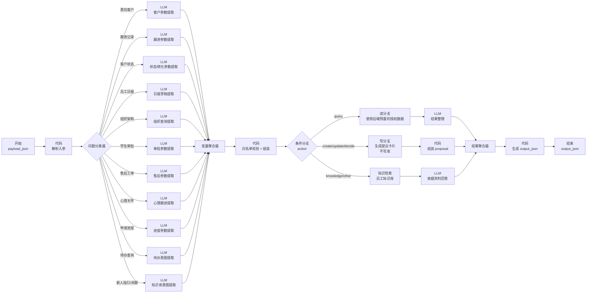

# M3 企业智能助手 · Dify 设计方案（评审稿）

> 依据：《客户需求表.xlsx》企业智能助手条目、交付文档 M3/02/04、现有 19 表与已交付 M2/M4 接口、
> 用户提供的 `学生管理系统与Dify智能对话应用.yml`（advanced-chat 格式）。
> 状态：设计评审，未开始编码；待确认项见 §8。

---

## 1. 目标与边界

**目标**：员工用自然语言（后续语音）完成客户录入/查询/跟进/状态更新、日报草稿、组织查询、新人指引、学生业务处理（审批/售后/心理跟进），并能在工作台看到实时待办。

**三条硬边界**（来自交付文档，不能因客户需求表而突破）：

| 边界 | 说明 |
|---|---|
| 不自由 SQL | 客户需求表写的 "NL2SQL" 改为 **结构化意图 + 预审查询模板**；Dify 无数据库账号、不执行任意 SQL |
| 写操作必须确认 | Dify 只输出意图/参数/提议卡片；员工确认后由 Python 调普通业务接口，再鉴权 + 乐观锁 + 幂等 |
| 敏感数据不出后端 | 投诉正文、心理观测、临时密码、完整客户库不进入 Dify 提示词；心理只给"有待复核事项" |
| 权限实时 | Dify 拿到的数据是 Python 按当前员工 Scope 过滤后的快照；模型无权扩大范围 |

**调用方向**：后端 → Dify（出站，云端 `8.138.150.132` 可达）；**不采用**样例的 Dify → 后端 HTTP 直连（本地后端无公网入站，且样例无鉴权/直连 CRUD 不可接受）。若未来要反向调用，必须使用服务端签发的短时令牌 + 路径白名单，不纳入本轮。

---

## 2. 与客户需求表的差异对账

| 客户需求 | 我们的实现 | 差异处理 |
|---|---|---|
| 意向客户录入（语音/文字） | 助手转写 → 草稿 → 员工核对 → `POST /employees/leads`（API034，复用 M2 `acquire_lead`） | 一致；"自动入库"改为"确认后入库" |
| 意向客户查询 | API032/033/038（权限内） | 一致 |
| 客户状态更新（已签约/已流失） | 流失/恢复走 API040；**"已签约"必须走转化 API043**（建学生账号+档案+课程） | 需向客户说明：签约不是简单改状态 |
| 口述日报 | 日报模块由 M5 负责（API082~087）；助手只做 `DAILY_DRAFT` 提议 | 依赖 M5 就绪 |
| 管理日报查阅 | M5 的 API087 | 依赖 M5 |
| 组织架构查询 | M1 的通讯录/部门接口（API007/009） | **M1-06~10 尚未完成**，助手先返回"能力未就绪" |
| 新人入职指引 | 员工知识库（RAG，仅员工受众） | 需真实制度文档；缺文档明确"资料不足" |
| 学生业务综管 | 审批 API054/055、售后 API059~062、心理 API070~072、成绩查询 API073/074 | 一致 |
| 成绩录入 | 维持 D02：**只查不写**（API073/074） | 已拍板（2026-10-17） |
| 4 张核心表 | 已按 19 表闭环建好（客户表/日报表/投诉表/成绩表均已存在），不重复建表 | 一致，只是表数更多 |
| NL2SQL | **已确认方案 A+**：白名单意图 + 预审查询模板 + 白名单聚合指标 | 已拍板（2026-10-17） |
| 主动待办推送 | M1 定时器 + 站内通知；助手打开时先展示待办（API088） | 不承诺"AI 主动私聊" |
| 指令式业务处理 | 提议卡片 + confirmation_token（5 分钟） | 一致 |

---

## 3. 意图白名单（15 个）与接口映射

| 意图 | 读/写 | 后端执行 | 前置依赖 |
|---|---|---|---|
| LEAD_CREATE | 写（提议） | API034 建客户 | M2 已就绪 |
| LEAD_SEARCH | 读 | API032/033/038 | M2/M3 已就绪 |
| FOLLOWUP_ADD | 写（提议） | API039 写跟进 | M2/M3 已就绪 |
| LEAD_CHANGE_STATUS | 写（提议） | API040 流失/恢复；SIGNED 提示走转化 | M3 已就绪 |
| LEAD_CONVERT | 写（提议） | API043 转学生（需二次确认） | M3 已就绪 |
| DAILY_DRAFT | 写（提议） | M5 日报保存/整理 | **M5 未交付** |
| DAILY_SEARCH | 读 | M5 日报查询 | **M5 未交付** |
| ORG_SEARCH | 读 | M1 通讯录/部门 | **M1-06~10 未完成** |
| SERVICE_LIST | 读 | API050 服务单列表 | M4 已就绪 |
| LEAVE_DECIDE | 写（提议） | API054 审批 | M4 已就绪 |
| FEEDBACK_LIST | 读 | API059 售后池 | M3 已就绪 |
| FEEDBACK_HANDLE | 写（提议） | API062 解决/转派 | M4 已就绪 |
| PSYCH_LIST | 读（敏感） | API070 预警列表 | M4 已就绪 |
| PSYCH_NOTE | 写（提议） | API072 NOTE | M4 已就绪 |
| APPLICATION_SEARCH | 读 | API078/079 | M4 已就绪 |
| APPLICATION_UPDATE | 写（提议） | API081 追加进度 | M3 已就绪 |

> 未就绪能力一律返回 `aiStatus=UNAVAILABLE` + 明确依赖说明，不假装成功。

### 3.1 白名单聚合指标（方案 A+）

| 指标 | 含义 | 可用维度 | 权限 |
|---|---|---|---|
| LEAD_COUNT | 客户数 | 状态 / 负责人 / 部门 / 时间 | 顾问本人 / 主管部门 / 管理员 |
| SIGNED_COUNT | 签约数 | 时间 / 部门 / 顾问 | 同上 |
| FOLLOWUP_COUNT | 跟进次数 | 时间 / 顾问 / 客户 | 同上 |
| FOLLOWUP_DUE_COUNT | 到期跟进数 | 负责人 | 本人 |
| SERVICE_PENDING_COUNT | 待审单数 | 类型 / 部门 | 审批人 / 主管 / 管理员 |
| FEEDBACK_OPEN_COUNT | 未结工单数 | 状态 / 优先级 / 部门 | 售后授权 + 部门 |
| APPLICATION_STAGE_COUNT | 进度阶段分布 | 事项类型 / 阶段 | 本人顾问 / 主管 / 管理员 |
| PSYCH_ALERT_COUNT | 待复核预警数 | 严重度 | 心理授权 + 范围 |

**参数约束**：

- `metric` / `group_by` / `time_range` 全部枚举白名单，**不接受任意字段名或表达式**
- 时间范围最长 1 年；默认本月；按业务时区 `Asia/Shanghai`
- 返回只含数字与口径说明，**不含客户/学生明细**；敏感指标不返回姓名
- 所有指标查询先 `build_scope` 过滤再聚合，越权维度直接拒绝

**示例**：员工问“A 部门这个月签约几个？”
→ Dify 输出 `{"intent":"METRIC_QUERY","metric":"SIGNED_COUNT","time_range":"THIS_MONTH","filters":{"dept":"本部门"}}`
→ Python 聚合后返回数字 → Dify 整理为“本部门本月签约 3 个”。

---

## 4. 工作流总体设计（WF_ENTERPRISE）

### 4.1 与样例格式的对应关系

你的 `学生管理系统与Dify智能对话应用.yml` 链路是：

`start → question-classifier → 每类 LLM 参数提取 → variable-aggregator → code 解析组装 → if-else(action) → http-request(get/post/put/delete) → variable-aggregator(body) → LLM 结果整理 → answer`

我们沿用**同样的节点形状和命名习惯**，只替换三处：

| 样例做法 | 本方案 | 原因 |
|---|---|---|
| `advanced-chat` + `sys.query` | `workflow` + `payload_json` 输入、`output_json` 输出 | 后端需要 blocking 调用与结构化输出（02 文档契约） |
| LLM 生成 `resource/path` 直接拼 URL | LLM 只输出**意图 + 参数**；Code 节点按**白名单**校验，未知意图降级 | 防提示词注入打任意接口 |
| Dify → 后端 HTTP（无鉴权、直连 CRUD） | Python 调 Dify（出站）；写操作只出提议 | 本地后端无公网入站；写必须确认/鉴权 |

### 4.2 节点清单

| # | 节点 | 类型 | 职责 |
|---|---|---|---|
| 1 | 用户输入 | start | 输入 `payload_json`（message/message_id/conversation_id/actor/授权数据/待办摘要） |
| 2 | 解析入参 | code (python3) | 解析 payload，产出 message、actor 能力、授权数据 JSON |
| 3 | 问题分类器 | question-classifier | 11 个业务类 + 知识库/闲聊 + 兜底 |
| 4.1~4.11 | 各类提取器 | llm ×11 | 输出严格 JSON：intent/action/params/missing_fields/draft，不输出解释文字 |
| 5 | 参数聚合 | variable-aggregator | 合并各类提取结果 |
| 6 | 白名单校验 | code (python3) | 校验 intent/action/字段白名单；未知降级 OTHER；删除高危参数 |
| 7 | 条件分支 | if-else | query / write / decide / knowledge / other |
| 8.1 | 读结果整理 | llm | 依据后端预置的授权数据回答（只返回文本） |
| 8.2 | 写提议生成 | code | 组装 proposal（operation/entity_id/preview/expected_version/request_key/missing_fields） |
| 8.3 | 知识检索 | knowledge-retrieval | 员工知识库（新人制度/业务指引） |
| 8.4 | 知识回答 | llm | 依据检索片段回答；无资料明确"资料不足" |
| 9 | 结果聚合 | variable-aggregator | 汇总分支输出 |
| 10 | 输出组装 | code (python3) | 生成 `output_json`（answer/intent/proposal/missing_fields/sources/warnings/ai_status） |
| 11 | 结束 | end | 输出 `output_json` |

### 4.3 写操作的提议结构（示例）

```json
{
  "schema_version": "1.0",
  "intent": "LEAVE_DECIDE",
  "action": "APPROVE",
  "answer": "将批准钱八的请假申请（10-20 09:00~17:00），请确认。",
  "proposal": {
    "operation": "DECIDE_SERVICE",
    "entityId": "301",
    "preview": {"studentName": "钱八", "serviceType": "LEAVE", "decision": "APPROVE"},
    "expectedVersion": 1,
    "requestKey": "uuid",
    "missingFields": []
  },
  "warnings": []
}
```

---

## 5. 工作流展示图



**与样例一致的视觉结构**：开始 → 分类器 → 多路 LLM 提取 → 聚合 → Code → 分支 → 分支节点 → 聚合 → LLM/Code → 结束。
**差异**：样例的分支后是 4 个 `http-request`；本方案把"读"换成后端预置数据总结、把"写"换成 proposal 输出（安全边界）。

---

## 6. Dify 侧配置要点

| 项 | 值 |
|---|---|
| 应用类型 | Workflow（推荐）；若要沿用 advanced-chat，则用 conversation 变量传 payload |
| 模型 | 沿用你已有 `langgenius/deepseek/deepseek`（deepseek-flash）；分类器与提取器 temperature 0.1~0.3，整理 0.7 |
| 输入 | `payload_json`（string，JSON） |
| 输出 | `output_json`（string，JSON） |
| 知识库 | 员工受众（公司信息/业务/制度/新人指引），与访客、学生库隔离 |
| 超时 | 问答 30s、提取 30s（后端可配） |
| API Key | `DIFY_ENTERPRISE_KEY` 只放后端 `.env`，不进 Git/Dify 提示词 |
| 语音 | 本轮跳过（API031 留空）；后续接 ASR 后走"转写草稿 → 员工核对" |

---

## 7. 语音、日报、待办的边界（避免重复建设）

- **语音**：本轮不实现 API031；Dify 的 speech_to_text 也保持关闭。后续接 ASR 供应商后，先转写再走同一套意图流程。
- **日报**：M5 负责页面与接口；助手只负责"识别日报意图 + 生成草稿提议"，真正保存/提交调用 M5 接口。
- **待办**：不做"AI 主动私聊"。M1 定时器生成去重站内通知；员工打开助手/工作台时先展示 API088 的实时待办。
- **组织架构**：依赖 M1 的 API007/009；未就绪前该意图返回"能力未就绪，请联系管理员"。

---

## 8. 需要你提供/确认的清单

### 8.1 已拍板（2026-10-17）

1. **NL2SQL**：采用 **方案 A+**（白名单意图 + 预审查询模板 + 白名单聚合指标）；不引入自由 SQL
2. **成绩录入**：维持 D02，**只查不写**
3. **写入执行方式**：**后端执行 + 提议确认**；Dify 不直连写接口
4. **日报归属**：M5 负责接口，企业助手只做草稿提议
5. **Dify 模型/Key**：先留空，由用户后续在 Dify 网页配置

### 8.2 需要你提供

1. Dify 实例的 **模型供应商与 API Key**（deepseek 是否已配好？key 由谁提供？）
2. **员工知识库文档**：公司信息、业务流程、入职制度、FAQ（没有就明确"资料不足"）
3. Dify 工作流的**应用名称/负责人**，以及是否允许我直接导出 `wf_enterprise.yml` 供你导入
4. 后端与 Dify 的**网络方向确认**：后端可出站访问 `8.138.150.132`（已实测），Dify 是否需要回调后端？
5. 语音 ASR 供应商（本轮可不提供，仅确认是否排入下一轮）

### 8.3 需要你确认的口径（已有多数默认值）

- 助手查询只返回**文本回答**（已确认）
- 会话上下文 **15 分钟**（已确认）
- 敏感数据不进 Dify：投诉正文、心理原文、临时密码、客户完整库
- 写操作 confirmation_token **5 分钟**、同 request_key 幂等
- 意图白名单以 §3 的 16 项为准（原 15 项 + LEAD_CONVERT）

---

## 9. 交付物（已交付，2026-10-17）

| 文件 | 状态 |
|---|---|
| `dify/wf_enterprise.yml` | ✅ 20 节点 / 29 连线，模型与知识库留空 |
| `dify/variables.md`（WF_ENTERPRISE 章节） | ✅ payload_json / output_json 与 21 意图契约 |
| `dify/eval_samples.md`（WF_ENTERPRISE 章节） | ✅ 评测样本 34 条 |
| `dify/Dify创建配置说明.md` | ✅ 导入/模型/知识库/API Key/联调/验收清单 |
| `backend/app/integrations/dify/enterprise.py` + `mock_samples.py` | ✅ mock/live + 输出契约校验 |
| `backend/app/services/enterprise_assistant_service.py` | ✅ 意图执行/消歧/提议签发/降级 |
| `backend/app/controllers/assistants.py`（API029） | ✅ 已实现 |
| `backend/tests/test_assistant.py` | ✅ 12 项全部通过 |
